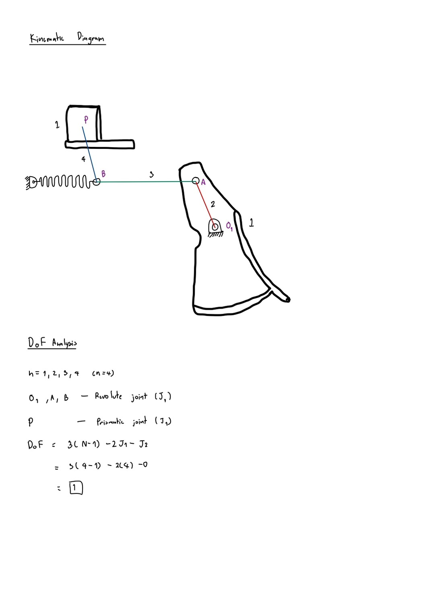

# Hot-Glue gun Mechanism

**Pongsapak Arunsawatwong (6730328721)**

This project analyzes the trigger-driven glue-stick feed mechanism of a hot-glue gun. The trigger, connecting link, and slider are modeled as a planar offset slider-crank with one degree of freedom. The MATLAB script derives slider position, displacement, velocity, acceleration, feed force, and mechanical advantage symbolically.



## Project files

- [Mechanism model and assumptions](docs/mechanism-analysis.md)
- [MATLAB symbolic analysis](simulation/hot_glue_gun_mechanism.m)
- [Hot-glue gun internal structure](media/internal-structure.jpg)

## Run the analysis

Open MATLAB with Symbolic Math Toolbox, set the current folder to the repository root, and run:

```matlab
run('simulation/hot_glue_gun_mechanism.m')
```